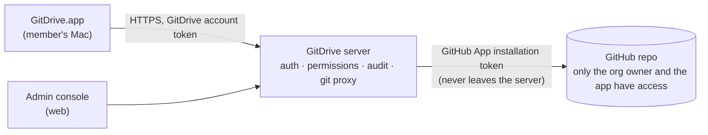

# CR-1: Members reach drives only through a GitDrive server

Status: **proposal, waiting for stakeholder approval** · Date: 2026-10-26 · Branch: docs/explore (draft)

## Requirement change (stakeholder's words)

> "it is not acceptable for member to keep local copy"

> "i won't accept the case where member has direct access to git repo as well"

## Classification

**Breaking.** This replaces D-1 (members are GitHub collaborators) and D-5 (users sign in with GitHub). It also changes D-4, D-8, S-4, S-7, S-8, the screens S-01, S-02 and S-08, and Q2 and Q13. Timing: **now**, before Stage 3 planning, since no code exists yet.

## What changes

Today's design gives every member their own GitHub access. Under CR-1, **only the GitDrive server talks to GitHub**. Members have GitDrive accounts, never GitHub access, so they can't clone, browse or force-push the repo themselves.

### Recommended shape: a git proxy server

- The server speaks git's smart HTTP protocol to the Mac app and forwards to GitHub with the GitHub App's installation token. The Rust engine keeps working almost unchanged, only pointed at the server instead of github.com.
- The server checks every request against GitDrive's own permissions, so per-drive roles (viewer, editor, admin) are enforced server-side, not just in the app.
- **The server rejects** force-pushes, branch deletion, and pushes that touch paths it doesn't allow. This closes AC-16's gap at the source.
- **Trash restore becomes truly admin-only**, because members hold no history to restore from (next point) and restore is a server API only admins can call.

### Limiting what's on a member's Mac

- **Current files only.** The Mac gets a shallow clone (the latest version, no history). The history panel and Trash load from the server on demand, so a member never holds old versions or deleted files.
- **Revoke wipes the copy.** When an admin removes a member or a device, the server marks it revoked. The app deletes the drive folder and its git data on its next check-in, which happens at least every 5 minutes while online.
- **Offline limit.** If a Mac can't reach the server for 14 days *(adjustable)*, the app deletes the local drive. Unsynced local changes are kept in an encrypted holding area until the device checks in again and is confirmed.
- **Device registration.** Each Mac is registered as a device under the member's account, so an admin can revoke a lost Mac without removing the person.

### Honest limits (still true with CR-1)

- While a member has access, they can copy files elsewhere (USB, email, screenshots). Only company-managed Macs with MDM or data-loss-prevention tools can stop that.
- A Mac that never comes back online keeps its copy until the offline limit passes *and* the app runs. Someone who deletes GitDrive keeps whatever files were in the folder. FileVault and MDM remote wipe are the backstop.

## Impact

| Area | Change |
|---|---|
| ACs | AC-1 (sign in with a GitDrive account, not GitHub), AC-10 (enforced by the server), AC-15 (enforced by the server), AC-16 (enforced by the server). New: **AC-20** members never get GitHub access; **AC-21** revoking a member or device removes the drive from their Mac at the next check-in; **AC-22** a Mac offline beyond the limit removes the drive. |
| Decisions | D-1 and D-5 superseded by D-9 (GitDrive server brokers access) and D-10 (GitDrive accounts). D-4 changes to shallow clones. D-8 becomes server-enforced. |
| Design | New S-17 server; S-4 rewritten; S-6 and S-7 load history and Trash from the server; S-8 permissions move to the server. |
| Screens | S-01 sign-in with a GitDrive account; S-02 drives come from the server; S-08 unchanged. New: S-11 admin console (members, devices, roles, revoke); S-12 "This drive was removed from this Mac". |
| Security | The server holds the GitHub App private key, which is the crown jewel. It needs secret storage, audit logs and backups. Accepted risks 1 and 4 go away, and E-30 is mostly closed. |
| Scope | Adds a server and a small web admin console to v1. **This is the biggest cost:** roughly as much work again as the Mac app, plus hosting and operations. |
| Q&A | Q2 and Q13 are revised: members no longer use GitHub at all. |

## New risk and spike

- **Shallow clones with libgit2:** libgit2 added shallow fetch in version 1.7, but pushing from a shallow clone and replaying commits on top of it need proving. **Spike S-CR1:** shallow clone, commit, fetch, replay and push through a test proxy with git2-rs. If it fails, the fallback is for the server to accept file uploads through its own API and make the commits itself.

## Questions for the stakeholder

1. **Member sign-in:** email with a one-time code (simplest), or Sign in with Google or Microsoft (better for companies)? Admins would still sign in to GitHub once, to connect repos.
2. **Hosting:** where should the server run? For example Fly.io or Render (simplest), AWS or Google Cloud (if you already use one), or self-hosted by each customer (more work, more control).
3. **Is the offline limit of 14 days right?**
4. **Approve CR-1?** If you approve, I'll update the design, decisions and mockups, then come back through the design gate.
