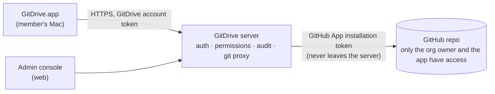

# CR-1: Members reach drives only through a GitDrive server

Status: **proposal, waiting for stakeholder approval** · Date: 2026-10-26 · Includes option B (Q17) · Branch: docs/explore (draft)

## Requirement change (stakeholder's words)

> "it is not acceptable for member to keep local copy"

> "i won't accept the case where member has direct access to git repo as well"

> "we should just allow app open thru gitdrive to prevent file leaking"

On the follow-up decision card the stakeholder chose **"B: View and edit only inside GitDrive"** (Q17).

## Classification

**Breaking.** This replaces D-1 (members are GitHub collaborators) and D-5 (users sign in with GitHub). It also changes D-4, D-8, S-4, S-7, S-8, the screens S-01, S-02 and S-08, and Q2 and Q13. Timing: **now**, before Stage 3 planning, since no code exists yet.

## What changes

Today's design gives every member their own GitHub access. Under CR-1, **only the GitDrive server talks to GitHub**. Members have GitDrive accounts, never GitHub access, so they can't clone, browse or force-push the repo themselves.

### Server shape (updated for option B)

- The server holds the only GitHub access (a GitHub App installation token) and keeps its own working clone of each drive repo. It makes every commit, under the member's name.
- The Mac app talks to the server's HTTPS API only: list folders, view or download into the encrypted cache, upload, open the editor, history, Trash. **No git runs on the Mac.**
- The server enforces GitDrive's own roles (viewer, editor, admin) on every request, and could later support per-folder permissions too.
- Only the server pushes to GitHub, and it never force-pushes. Trash restore is a server action only admins can call.
- Even a GitHub org owner editing the repo directly still works: the server fetches and picks up their commits.

### Limiting what's on a member's Mac (first draft, partly replaced by option B below)

- ~~Current files only, as a shallow clone.~~ Replaced by the encrypted cache (option B). History and Trash load from the server on demand, so a member never holds old versions or deleted files.
- **Revoke wipes the copy.** When an admin removes a member or a device, the server marks it revoked. The app deletes the drive folder and its git data on its next check-in, which happens at least every 5 minutes while online.
- **Offline limit.** If a Mac can't reach the server for 14 days *(adjustable)*, the app deletes the local drive. With option B there are no unsynced local edits, since editing needs a connection.
- **Device registration.** Each Mac is registered as a device under the member's account, so an admin can revoke a lost Mac without removing the person.

### Files open only inside GitDrive (option B)

This replaces "Limiting what's on a member's Mac" above wherever the two differ.

- **No plain folder.** There is no `~/GitDrive` folder. The Mac keeps only an **encrypted cache** of recently opened files, with the key in the Keychain, and it's wiped on revoke or after the offline limit.
- **Viewing in the app:** PDFs (PDFKit), images, and text and Markdown files show in GitDrive's own viewer. Office files open in the embedded editor in read-only mode.
- **Editing in the app:** Word, Excel and PowerPoint files (docx, xlsx, pptx and the OpenDocument formats) are edited in an office editor that runs on the GitDrive server and shows inside the app window. Recommended: **ONLYOFFICE Docs** or **Collabora Online**. Several people can edit the same document at once, so most conflicts disappear. Photos and PDFs are view-only in v1: to change one, a member uploads a new version.
- **The server makes every commit.** Saves from the editor and uploads become commits on the server, under the member's name. **The Mac app no longer needs git at all.** The Rust core shrinks to an API client plus the encrypted cache, which is still shared with Android later. This removes the shallow-clone risk and most of the sync engine (S-5).
- **Blocked for members:** download and export, copy out of the editor, printing, and drag-out to Finder. The GitDrive window is excluded from screenshots and screen recording (macOS `NSWindow.sharingType = .none`). **Admins can export**, and each export is logged.
- **Adding files** is still allowed: drag in from Finder, or use an Add files button.
- **Offline:** cached files can be *viewed* until the offline limit. Editing needs a connection.

### Honest limits (still true with CR-1)

- With option B, copying out is blocked inside the app, but a member can still photograph the screen or retype content. Some screen-capture tools may ignore the window exclusion. No software can fully stop that.
- A Mac that never comes back online keeps its encrypted cache, but without a valid session the cache can't be opened, and it's wiped when the app next runs.

## Impact (with option B)

| Area | Change |
|---|---|
| ACs | **Replaced:** AC-3 (open in usual apps → open in GitDrive's viewer and editor), AC-6 to AC-8 (sync conflicts and offline editing → handled by the server and co-editing; offline is view-only), AC-9a (size cap applies to uploads), AC-19 (save storms → handled by the editor server). **Changed:** AC-1 (GitDrive account sign-in), and AC-10, AC-15 and AC-16 (enforced by the server). **New:** AC-20 members never get GitHub access; AC-21 revoking a member or device wipes the cache at next check-in; AC-22 the offline limit wipes the cache; AC-23 files can be viewed and edited only inside GitDrive, with export, copy, print and screen capture blocked by default; AC-24 several members can edit one office document at the same time. |
| Decisions | Superseded: D-1 → D-9 (GitDrive server brokers access), D-3 → D-11 (in-app viewer and embedded editor instead of usual apps), D-4 → D-12 (server-side commits, encrypted cache, no git on the Mac), D-5 → D-10 (GitDrive accounts). D-2 is narrowed: the Rust core becomes an API client plus cache. D-8 becomes server-enforced. |
| Design | New S-17 server (API, git, editor host, admin console). S-3 and S-5 are replaced by an encrypted cache and server sync. S-4, S-6, S-7 and S-8 move to the server. Many edge cases go away (E-1 to E-4, E-15 to E-18, E-23); new ones arrive (editor security, cache encryption). |
| Screens | Changed: S-01 sign-in, S-02 drives from the server, S-03 browser without a folder, S-04 history from the server, S-06 conflicts (mostly gone with co-editing). New: S-11 admin console, S-12 "removed from this Mac", **S-13 document editor in the app**, **S-14 file viewer**. S-09 becomes an upload limit. |
| Security | The server is now the single trust point: it holds the GitHub App key and every file passes through it. It needs hardening, audit logs, backups and monitoring. The editor server must be kept patched. |
| Scope and cost | v1 grows into the Mac app, the GitDrive server, an office editor server and a web admin console. The Mac app gets simpler (no git, no file sync), but the server side grows a lot. The editor needs a license for business use (ONLYOFFICE Docs Enterprise, or a Collabora Online subscription); the free editions limit connections or are for development only. |
| Q&A | Q2, Q13 revised. |

## Mac app or web app?

GitDrive stays a **native Mac app** for members, with a **web admin console** for admins. A web app would be quicker to build, but it can't deliver the leak protection option B promises: a browser can't hide its window from screenshots, it has no Keychain-protected encrypted cache for 14-day offline viewing, and print, save and developer tools are hard to lock down. The Mac app is a native shell around server-driven content: native file browser, viewers and encrypted cache, with the office editor shown inside it. A member web app could come later with clearly weaker protection (Q18).

## New risks and spikes

- **Embedded editor in a Mac app:** ONLYOFFICE and Collabora are web editors, so they run inside a WKWebView. Spike S-CR1: embed one, open, edit and save a docx through our server, with copy, print and download turned off.
- **Screen capture exclusion:** check that `sharingType = .none` blocks the built-in screenshot tool, screen recording and screen sharing on macOS 14 and 15.
- **Editor licensing cost** for 10 to 50 users per team.

## Questions for the stakeholder

1. ~~Member sign-in?~~ **Answered:** "member sign-in by email code". Admins still sign in to GitHub once, to connect repos.
2. ~~Hosting?~~ **Answered:** "we do self-host". The server ships as a Docker Compose bundle (GitDrive server, office editor, Postgres, reverse proxy with TLS) that runs on one Linux machine. Email sign-in codes go out through an SMTP server you configure. This works whether you run it for your own team or each customer runs their own.
3. ~~Offline limit?~~ **Answered:** 14 days, view-only ("ues", read as yes).
4. **Office editor:** ONLYOFFICE (closest to Microsoft Office, paid per simultaneous editor) or Collabora (LibreOffice-based, subscription)? I'd recommend ONLYOFFICE for compatibility with Word and Excel files.
5. ~~Export?~~ **Answered:** "admin can export". Read as: admins can export files; members can't.
6. **Approve CR-1?** If you approve, I'll update the design, decisions and mockups, then come back through the design gate.
