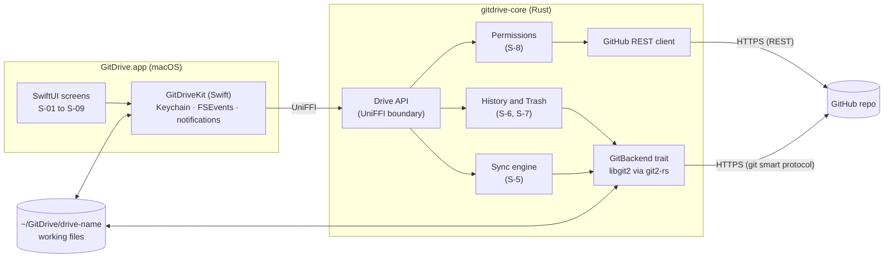
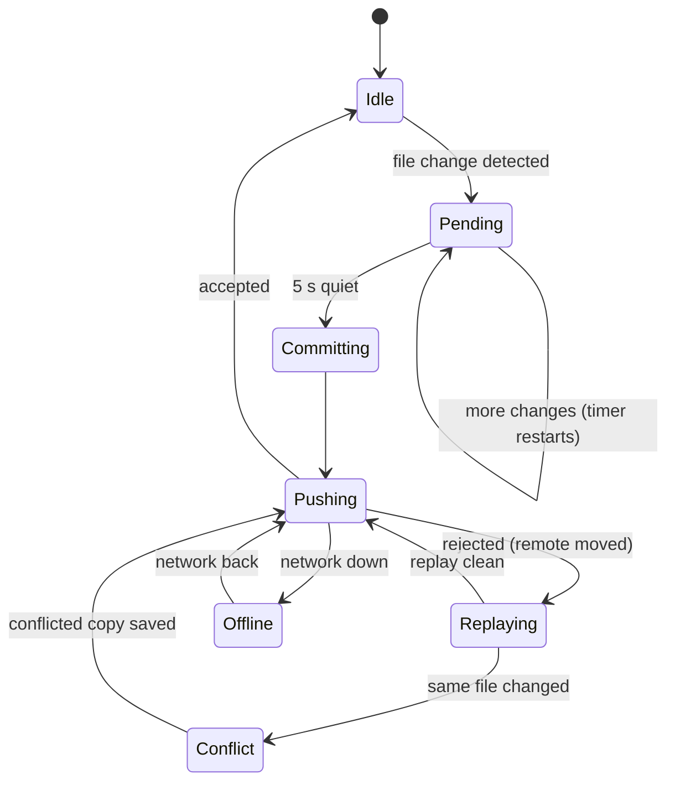

# GitDrive: Stage 2 design (v1)

Status: **approved by the stakeholder on 2026-10-26 ("sure, go for mockup")** · Date: 2026-10-26
Inputs: [explore.md](explore.md) (approved), decisions [D-1 to D-8](decisions/)

## S-1. Overview

GitDrive is a Mac app that shows a private GitHub repo as a shared drive. People browse folders, open files in their usual apps, add, rename and remove files, and see or restore any earlier version. Every change becomes a git commit under the person's own name, and GitHub handles accounts, teams and access.

v1 has three parts:

1. **gitdrive-core** (Rust): all git, sync, history, trash and permission logic. No UI and no Apple-only code (D-2, AC-12).
2. **GitDriveKit** (Swift): the core exposed to Swift through UniFFI, plus the Mac-only pieces: Keychain, file watching, notifications.
3. **GitDrive.app** (SwiftUI): the window app (D-3).

## S-2. Architecture

The engine never shows its own UI. It reports events (sync state, conflicts, errors) through a callback interface that the Swift layer turns into UI and notifications. Platform services the engine needs (secure token storage, network reachability) are passed in as callback interfaces, so Android can supply its own later.

### Crate and target layout

| Path | What it is |
|---|---|
| `core/gitdrive-core` | Rust library: domain logic, `GitBackend` trait, libgit2 backend, GitHub client |
| `core/gitdrive-ffi` | UniFFI bindings, builds an XCFramework for macOS (and later iOS) |
| `core/gitdrive-cli` | Small CLI over the same API, used for tests and load simulation (AC-6, AC-7) |
| `apple/GitDriveKit` | Swift package wrapping the XCFramework, Keychain, FSEvents |
| `apple/GitDrive` | SwiftUI app, Sparkle updater |

CI builds `gitdrive-core` for `aarch64-apple-darwin`, `x86_64-apple-darwin` and `aarch64-linux-android` (compile only) to hold AC-12.

## S-3. Files on disk

| Location | Contents |
|---|---|
| `~/GitDrive/<drive name>/` | The working files. This is a normal folder, so any app can open and save files in it (AC-3). |
| `~/Library/Application Support/GitDrive/repos/<owner>/<repo>.git` | The git directory, kept outside the working folder (`--separate-git-dir`) so users can't see or damage it. |
| `~/Library/Application Support/GitDrive/state.sqlite` | Drive list, sync queue state, last-seen permissions, settings. |
| macOS Keychain | GitHub tokens only (AC-13). |

Because v1 is a direct download (D-6) with no sandbox, keeping working files in a plain folder is allowed and gives the best "open in my usual app" behaviour.

## S-4. Sign-in and drives

1. **Sign in (S-01).** The app starts the GitHub App device flow: it shows a short code and opens github.com/login/device. The user approves, and the app gets a user access token (8-hour lifetime) and a refresh token. Both go into the Keychain (D-5). The engine refreshes the token on its own when it expires.
2. **Pick a drive (S-02).** The engine lists the repos where the GitDrive GitHub App is installed and the user has access (`GET /user/installations/{id}/repositories`). The user picks one and names the drive, and the engine clones it. If the repo the user wants isn't listed, the screen explains that an org admin needs to install the GitHub App on it.
3. **Commit identity.** Commits use the user's GitHub name and their `<id>+<login>@users.noreply.github.com` address, so history shows real people (AC-4, AC-5).

GitHub App permissions requested: **Contents: read and write**, **Metadata: read**. Nothing else.

## S-5. Sync engine (D-4)

### Local changes to GitHub

- **Detect.** FSEvents on the working folder reports changed paths. Temporary files (`~$*`, `.~lock*`, `*.tmp`, `.DS_Store`) are ignored using a built-in ignore list plus the repo's `.gitignore`.
- **Batch.** Changes wait for 5 seconds of quiet, then go out as one commit with a readable message, for example `Update Budget.xlsx` or `Add 3 files to Photos/2026`.
- **Size cap (AC-9a).** Before committing, files over 25 MB raise a warning and files over 50 MB are left out of the commit, and the user is told why (S-09).
- **Push.** On a rejected push the engine fetches, replays local commits on top of the new remote head, and pushes again. It retries up to 5 times with growing delays (1, 2, 4, 8, 16 s plus jitter) before showing "Sync delayed" without losing anything (AC-6).
- **Offline (AC-8).** Commits stay in the local repo and the queue state is saved. When the network returns, the push resumes. Nothing depends on the app staying open, because the commits themselves are the queue.

### GitHub changes to this Mac

- The engine fetches every 30 seconds while the app runs, and right away when the app comes to the front.
- If there are no local changes, it fast-forwards the working files.
- If there are local changes, it commits them first, then replays as above.
- Files are updated by writing to a temp file and renaming, so an app never sees a half-written file.

### Conflicts (AC-7)

When the same file changed on both sides, the version already on GitHub stays as the file. The local version is saved next to it as `<name> (<user>'s conflicted copy <yyyy-mm-dd>).<ext>`, committed, and pushed. The user gets a notification (S-06) and the file is marked in the browser. Text merges are never attempted automatically in v1, because office files and photos can't be merged safely.

## S-6. History and restore (AC-5)

- **History panel (S-04)** lists a file's versions from `git log --follow`: author, time and message, newest first, loaded in pages of 50.
- **Preview** opens an old version as a read-only temp copy in its usual app.
- **Restore** writes the old content back to the file and commits `Restore Budget.xlsx to version from 2026-10-20`. History is never rewritten.

## S-7. Remove and Trash (AC-15, D-8)

- **Remove** deletes the file or folder from the working tree and commits `Remove Budget.xlsx`. The commit carries a `GitDrive-Removed-By: <login>` trailer.
- **Trash view (S-05)** is built from history: every path deleted in a commit and not present now. No extra storage is needed.
- **Restore from Trash** recreates the files from the commit before the removal and commits `Restore Budget.xlsx from Trash`. File history continues across the gap.
- **Who can restore:** repo admins (GitHub `admin` or `maintain` permission). Only admins can restore, including files a user removed themselves (stakeholder: "only admin can restore files"). Editors and viewers can see the Trash but the Restore button is hidden for them.
- **Delete:** treated exactly like Remove in v1. A permanent purge would rewrite history for everyone and is not designed here.

Note on enforcement: GitHub enforces read versus write. "Only admins restore" is enforced by the app, not by GitHub, because anyone with write access could restore a file with plain git. See [security.md](security.md).

## S-8. Permissions (AC-10)

The engine reads `permissions` from `GET /repos/{owner}/{repo}` when a drive opens and every 10 minutes after.

| GitHub permission | GitDrive role | Can do |
|---|---|---|
| `pull` (read) | Viewer | Browse, open, history, preview. Working folder is set read-only on disk, and the engine refuses commits. |
| `push`, `triage` | Editor | Everything except restoring from Trash |
| `maintain`, `admin` | Admin | Everything, including restoring any Trash item |

If GitHub rejects a push with 403, the engine treats the drive as read-only, keeps the local commits, and asks the user to contact an admin.

## S-9. Screens

| Id | Screen | Main ACs |
|---|---|---|
| S-01 | Sign in with GitHub (device code) | AC-1, AC-13 |
| S-02 | Pick a drive (repo list, name the drive, first-sync progress) | AC-1 |
| S-03 | Drive browser: sidebar of drives, folder list with icon, name, modified, modified by, sync badge; toolbar with Add, New folder, Remove, History | AC-2, AC-3, AC-4 |
| S-04 | History panel (right inspector) with Preview and Restore | AC-5 |
| S-05 | Trash: removed items, removed by, date, Restore (admins) | AC-15 |
| S-06 | Conflict notification and "conflicted copy" badge | AC-7 |
| S-07 | Sync status in the toolbar and menu bar: up to date, syncing, offline (n changes waiting), delayed | AC-6, AC-8 |
| S-08 | Read-only banner for viewers | AC-10 |
| S-09 | File too large dialog (25 MB warn, 50 MB block) | AC-9a |

Mockups: [GitDrive Mac app mockups](https://claude.ai/artifact/4AzEEz7MRKsMNJr1uQ2rqj) (canvas), source in [mockups/](mockups/). One artboard per screen id.

## S-10. Release and updates (D-6)

- Signed with a Developer ID certificate and notarized in CI (GitHub Actions on a macOS runner).
- Sparkle 2 for auto-updates, with an EdDSA-signed appcast hosted on GitHub Releases.
- Minimum macOS version: 14 (Sonoma).

## S-11. Testing

- **Engine unit tests** in Rust against local bare repos: commit, replay, conflict naming, trash listing, restore.
- **Multi-user simulation** with `gitdrive-cli`: 2 to 20 simulated users editing the same repo at once, checking that every change lands and no data is lost (AC-6, AC-7, AC-8).
- **Integration tests** against a real private test repo on GitHub, run in CI with a dedicated test account.
- **App UI tests** (XCUITest) for the main flows on S-01 to S-05.
- **Performance check:** a generated 10,000-file drive; opening a folder must take under 2 s (AC-2).

## S-12. Troubleshooting

| Symptom | Likely cause | What the app does or shows |
|---|---|---|
| Repo missing from the picker | GitHub App not installed on it | Explains, with a link for the org admin |
| "Sync delayed" | Repeated push rejections or GitHub outage | Keeps retrying; all changes safe locally |
| Drive turned read-only | Access was lowered on GitHub | Banner, local changes kept, contact admin |
| "File too large" | Over 50 MB (no LFS until v1.1) | Explains the limit, file stays local and unsynced |
| Signed out | Refresh token expired or revoked | Asks to sign in again, nothing lost |

## S-13. Traceability

| AC | Covered in |
|---|---|
| AC-1 | S-4, S-01, S-02 |
| AC-2 | S-3, S-03, S-11 |
| AC-3 | S-3, S-5 |
| AC-4 | S-4, S-5 |
| AC-5 | S-6, S-04 |
| AC-6 | S-5, S-11 |
| AC-7 | S-5, S-06 |
| AC-8 | S-5, S-07 |
| AC-9a | S-5, S-09 |
| AC-10 | S-8, S-08 |
| AC-12 | S-2 |
| AC-13 | S-3, S-4, security.md |
| AC-15 | S-7, S-05 |
| AC-9, AC-11, AC-14 | v1.1 (backlog B-1 to B-3) |

## S-14. Risks

- **Repo growth before LFS:** every saved edit of a photo or office file adds a full copy. Mitigated by the size cap; v1.1 adds LFS.
- **Push contention at 50 users:** to be measured with the simulation in S-11 before release.
- **Open-file edits during a pull:** an app with a file open may overwrite a newer version on save. That case ends in a conflicted copy, so no data is lost, but users may see more conflicted copies than expected.
- **GitHub App install step:** an org admin has to install the app once, which is an extra setup step for teams.
- **Client-side Trash permission:** "admins restore" is a convention the app enforces, not GitHub.

## S-15. Open questions

1. **Delete vs remove** (from explore.md question 6): should "delete" also go to Trash? **Answered:** "ok", so delete goes to Trash, same as remove. ~~Should users restore their own removed files?~~ **Answered:** "only admin can restore files".
2. ~~Minimum macOS version?~~ **Answered:** "ok", macOS 14 (Sonoma) or later.
